# Results

This page is generated by `make_figures.py` from the tables in `results/tables/`. Do not edit it by hand.

## Setup

Every method continues training from the source-only model of its transfer and seed, on 12 transfers and 5 seeds (52, 100, 445, 545, 881), with labelled source data and unlabelled target training windows. Each method has its own control run: the same loop, the same target forward pass and the same source loss weight, but with the alignment weight set to 0. Target labels are read only after all training has finished, to compute the metrics below on the target test split of the last epoch.

Values are mean ± sample standard deviation over the seeds, in percent. A group value is first averaged over the transfers of the group within each seed.

## Overview

**Weighted F1, target test**

| Variant | All 12 | Cross-dataset (6) | Cross-gender (4) | Cross-age (2) |
|---|---:|---:|---:|---:|
| Baseline | 41.9 ± 1.0 | 25.1 ± 1.6 | 65.2 ± 1.3 | 45.7 ± 3.5 |
| Deep CORAL | 45.7 ± 1.8 | 29.5 ± 3.9 | 67.3 ± 2.1 | 51.1 ± 3.4 |
| CORAL control | 43.4 ± 2.0 | 26.5 ± 3.8 | 65.9 ± 2.3 | 49.2 ± 6.4 |
| DANN | 52.6 ± 1.0 | 39.7 ± 2.4 | 69.0 ± 2.9 | 58.3 ± 3.0 |
| DANN control | 44.6 ± 1.5 | 29.5 ± 1.7 | 65.7 ± 1.2 | 48.0 ± 2.8 |
| DSAN | 52.7 ± 3.0 | 36.4 ± 5.9 | 73.8 ± 1.6 | 59.7 ± 4.1 |
| DSAN control | 44.5 ± 1.7 | 29.9 ± 2.7 | 65.0 ± 3.4 | 47.7 ± 2.5 |

**Macro-F1, target test**

| Variant | All 12 | Cross-dataset (6) | Cross-gender (4) | Cross-age (2) |
|---|---:|---:|---:|---:|
| Baseline | 40.7 ± 1.2 | 22.8 ± 1.5 | 64.6 ± 1.6 | 46.3 ± 3.0 |
| Deep CORAL | 44.0 ± 1.8 | 26.2 ± 3.6 | 66.6 ± 2.1 | 52.3 ± 3.2 |
| CORAL control | 42.0 ± 2.2 | 24.0 ± 3.7 | 64.9 ± 3.3 | 50.5 ± 5.1 |
| DANN | 50.7 ± 0.8 | 37.1 ± 2.6 | 66.8 ± 3.3 | 59.1 ± 3.1 |
| DANN control | 43.1 ± 1.7 | 26.4 ± 2.2 | 65.1 ± 1.1 | 49.2 ± 2.7 |
| DSAN | 52.0 ± 3.4 | 34.7 ± 6.3 | 72.3 ± 1.7 | 63.2 ± 3.1 |
| DSAN control | 42.9 ± 1.9 | 27.1 ± 2.5 | 63.6 ± 4.1 | 49.0 ± 3.5 |

**Accuracy, target test**

| Variant | All 12 | Cross-dataset (6) | Cross-gender (4) | Cross-age (2) |
|---|---:|---:|---:|---:|
| Baseline | 44.6 ± 1.3 | 27.3 ± 2.3 | 66.9 ± 1.1 | 51.9 ± 3.4 |
| Deep CORAL | 47.4 ± 1.1 | 30.2 ± 2.8 | 69.0 ± 2.2 | 56.2 ± 3.3 |
| CORAL control | 45.7 ± 1.9 | 28.1 ± 3.8 | 67.7 ± 2.2 | 54.6 ± 5.5 |
| DANN | 54.2 ± 1.1 | 40.7 ± 2.8 | 70.6 ± 2.2 | 61.6 ± 2.6 |
| DANN control | 46.8 ± 1.6 | 30.7 ± 1.7 | 67.3 ± 1.3 | 54.1 ± 2.8 |
| DSAN | 54.1 ± 3.1 | 36.8 ± 6.1 | 75.5 ± 1.4 | 63.3 ± 3.5 |
| DSAN control | 46.9 ± 1.5 | 31.5 ± 2.9 | 66.7 ± 3.1 | 53.4 ± 2.7 |

## Paired differences

Difference in weighted F1 on target test in percentage points, paired by seed: mean ± SD of the five per-seed differences, and in brackets the number of seeds in which the method is higher.

| Difference | All 12 | Cross-dataset (6) | Cross-gender (4) | Cross-age (2) |
|---|---:|---:|---:|---:|
| Deep CORAL − own control | +2.2 ± 2.3 (4/5) | +2.9 ± 4.2 (4/5) | +1.4 ± 1.2 (4/5) | +1.9 ± 3.9 (4/5) |
| Deep CORAL − baseline | +3.8 ± 2.1 (5/5) | +4.4 ± 4.6 (4/5) | +2.1 ± 3.1 (4/5) | +5.4 ± 5.4 (5/5) |
| DANN − own control | +7.9 ± 1.0 (5/5) | +10.3 ± 2.2 (5/5) | +3.3 ± 3.2 (4/5) | +10.3 ± 3.0 (5/5) |
| DANN − baseline | +10.7 ± 1.8 (5/5) | +14.7 ± 3.8 (5/5) | +3.8 ± 3.8 (4/5) | +12.6 ± 4.3 (5/5) |
| DSAN − own control | +8.2 ± 3.6 (5/5) | +6.5 ± 5.9 (5/5) | +8.8 ± 4.5 (5/5) | +12.0 ± 3.9 (5/5) |
| DSAN − baseline | +10.9 ± 2.8 (5/5) | +11.3 ± 6.1 (5/5) | +8.6 ± 1.1 (5/5) | +14.0 ± 3.3 (5/5) |

Per transfer, each method minus own control:

| Transfer | Deep CORAL | DANN | DSAN |
|---|---:|---:|---:|
| PAMAP2 → RealWorld | +10.9 ± 6.5 (5/5) | +30.4 ± 8.1 (5/5) | +19.0 ± 13.8 (5/5) |
| RealWorld → PAMAP2 | +8.6 ± 5.4 (5/5) | +16.1 ± 9.9 (5/5) | +26.6 ± 16.2 (5/5) |
| PAMAP2 → MHEALTH | +4.6 ± 5.5 (4/5) | +9.4 ± 15.4 (4/5) | −0.8 ± 14.5 (4/5) |
| MHEALTH → PAMAP2 | −0.6 ± 18.1 (1/5) | −5.4 ± 17.3 (3/5) | −4.8 ± 14.1 (2/5) |
| RealWorld → MHEALTH | −5.6 ± 7.5 (1/5) | −1.6 ± 14.3 (2/5) | +2.6 ± 7.0 (2/5) |
| MHEALTH → RealWorld | −0.4 ± 12.2 (3/5) | +12.7 ± 12.4 (4/5) | −3.4 ± 9.1 (2/5) |
| PAMAP2 male → female | +2.7 ± 3.3 (4/5) | +8.3 ± 6.5 (5/5) | +8.2 ± 4.8 (5/5) |
| PAMAP2 female → male | +2.0 ± 2.0 (5/5) | −1.3 ± 4.0 (2/5) | +1.5 ± 7.0 (3/5) |
| RealWorld male → female | +0.1 ± 1.1 (3/5) | +4.5 ± 4.2 (4/5) | +16.7 ± 5.8 (5/5) |
| RealWorld female → male | +0.7 ± 2.1 (3/5) | +1.6 ± 4.8 (3/5) | +8.9 ± 8.1 (4/5) |
| RealWorld <30 → ≥30 | +0.9 ± 5.6 (4/5) | +18.9 ± 7.2 (5/5) | +15.6 ± 4.6 (5/5) |
| RealWorld ≥30 → <30 | +2.8 ± 2.9 (5/5) | +1.6 ± 2.5 (3/5) | +8.3 ± 4.2 (5/5) |

Per transfer, each method minus the baseline:

| Transfer | Deep CORAL | DANN | DSAN |
|---|---:|---:|---:|
| PAMAP2 → RealWorld | +14.9 ± 9.8 (5/5) | +36.7 ± 11.7 (5/5) | +26.9 ± 20.2 (4/5) |
| RealWorld → PAMAP2 | +19.4 ± 12.9 (5/5) | +29.2 ± 19.0 (5/5) | +37.3 ± 17.7 (5/5) |
| PAMAP2 → MHEALTH | −0.9 ± 10.1 (2/5) | +14.2 ± 17.0 (4/5) | +3.7 ± 12.5 (3/5) |
| MHEALTH → PAMAP2 | −5.3 ± 13.8 (1/5) | −9.2 ± 18.4 (2/5) | −9.8 ± 13.0 (1/5) |
| RealWorld → MHEALTH | −5.7 ± 7.9 (2/5) | −0.4 ± 12.1 (2/5) | +4.5 ± 11.3 (2/5) |
| MHEALTH → RealWorld | +3.9 ± 8.0 (3/5) | +17.4 ± 8.7 (5/5) | +5.3 ± 4.7 (4/5) |
| PAMAP2 male → female | +6.7 ± 8.1 (3/5) | +12.0 ± 9.3 (5/5) | +13.1 ± 6.3 (5/5) |
| PAMAP2 female → male | +4.6 ± 5.3 (4/5) | +1.3 ± 6.9 (4/5) | +0.7 ± 9.4 (2/5) |
| RealWorld male → female | −0.8 ± 4.7 (2/5) | +2.6 ± 3.6 (4/5) | +13.4 ± 7.1 (5/5) |
| RealWorld female → male | −2.3 ± 3.9 (1/5) | −0.6 ± 4.2 (2/5) | +7.2 ± 4.7 (5/5) |
| RealWorld <30 → ≥30 | +7.9 ± 4.1 (5/5) | +22.4 ± 6.9 (5/5) | +21.9 ± 7.3 (5/5) |
| RealWorld ≥30 → <30 | +2.9 ± 8.9 (2/5) | +2.8 ± 6.0 (3/5) | +6.1 ± 9.6 (4/5) |

## Figures

**Figure 1.** Weighted F1 on target test per group of transfers for the baseline, the methods and their controls (hatched); error bars show the SD over the seeds.

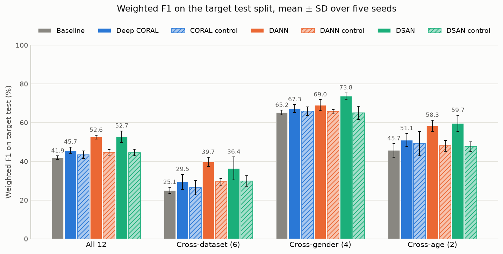

**Figure 2.** Each method minus its own control per transfer: one small point per seed, the diamond is the mean of the seeds; points right of the zero line mean the method is higher.

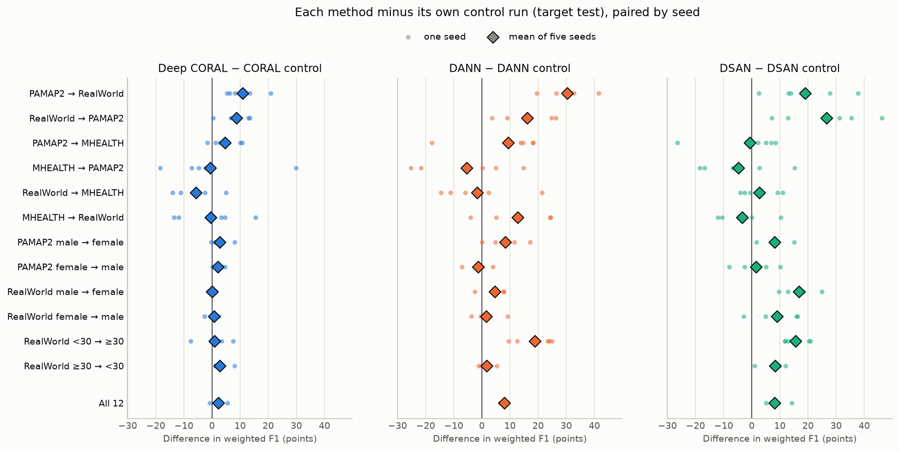

**Figure 3.** Mean difference in weighted F1 between each method and the baseline for every transfer and group; blue cells are above the baseline, red cells below.

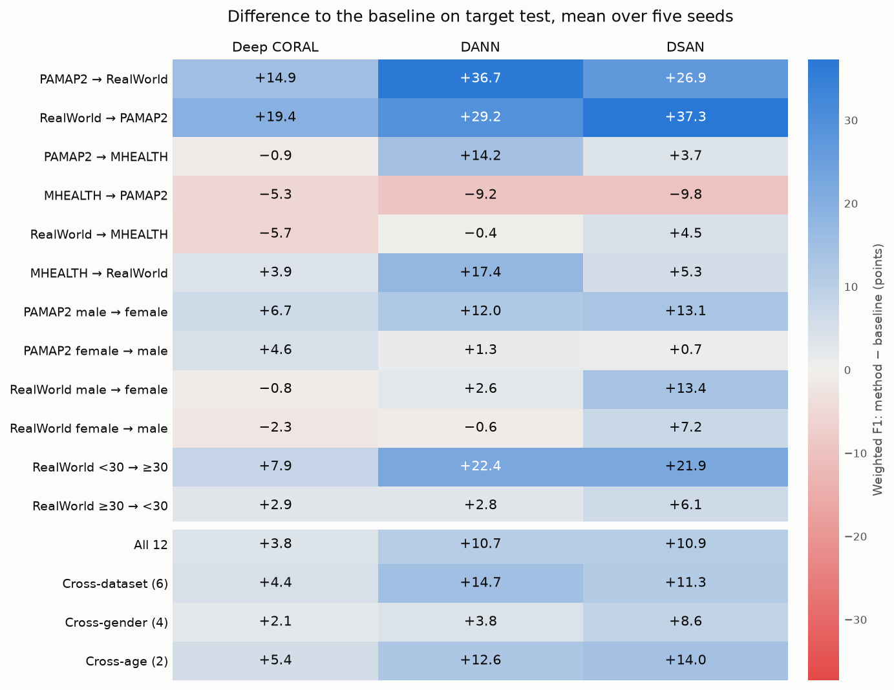

**Figure 4.** Accuracy of a logistic regression (5-fold cross-validation) that separates source-train from target-train windows on the frozen 96-dimensional features; controls are drawn as open circles.

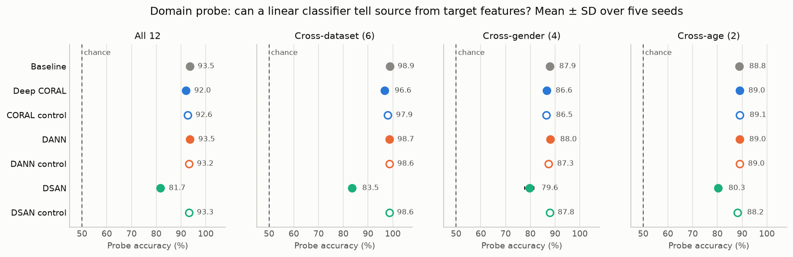

**Figure 5.** Row-normalised confusion matrices on target test for MHEALTH → PAMAP2, averaged over the seeds, for Baseline, Deep CORAL, DSAN (best and worst method by mean weighted F1 on this transfer).

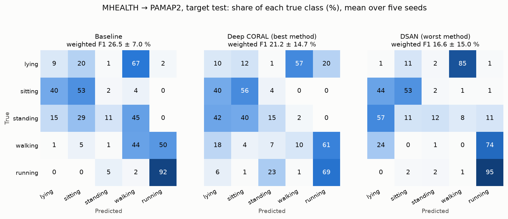

**Figure 6.** Training time of the training loop on an Apple M1 with MPS, summed over all runs of a variant and as mean per run; the baseline row covers only the source-only models trained in this project.

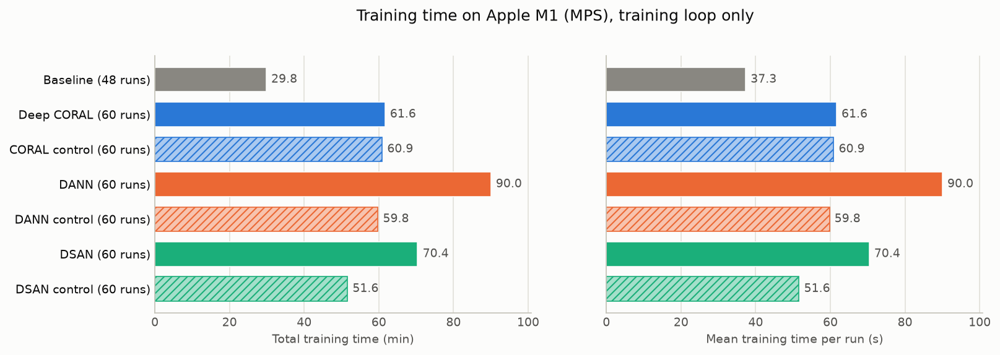

## Observations

Only statements that follow directly from the tables; no causes are claimed.

- Averaged over all transfers, weighted F1 on target test is 41.9 ± 1.0 % for Baseline, 45.7 ± 1.8 % for Deep CORAL, 52.6 ± 1.0 % for DANN, 52.7 ± 3.0 % for DSAN.
- Deep CORAL minus its own control: +2.2 ± 2.3 (4/5) points over all transfers (in brackets: seeds in which the method is higher). By group: Cross-dataset (6): +2.9 ± 4.2 (4/5); Cross-gender (4): +1.4 ± 1.2 (4/5); Cross-age (2): +1.9 ± 3.9 (4/5).
- DANN minus its own control: +7.9 ± 1.0 (5/5) points over all transfers (in brackets: seeds in which the method is higher). By group: Cross-dataset (6): +10.3 ± 2.2 (5/5); Cross-gender (4): +3.3 ± 3.2 (4/5); Cross-age (2): +10.3 ± 3.0 (5/5).
- DSAN minus its own control: +8.2 ± 3.6 (5/5) points over all transfers (in brackets: seeds in which the method is higher). By group: Cross-dataset (6): +6.5 ± 5.9 (5/5); Cross-gender (4): +8.8 ± 4.5 (5/5); Cross-age (2): +12.0 ± 3.9 (5/5).
- The control runs (continued training with a target forward pass, alignment weight 0) minus the baseline: +1.6 ± 2.5 (4/5) (CORAL control), +2.8 ± 2.1 (5/5) (DANN control), +2.7 ± 2.3 (4/5) (DSAN control) points.
- DANN minus Deep CORAL: +6.9 ± 2.0 (5/5) points over all transfers. By group: Cross-dataset (6): +10.3 ± 4.0 (5/5); Cross-gender (4): +1.8 ± 1.3 (5/5); Cross-age (2): +7.2 ± 5.9 (5/5).
- DSAN minus Deep CORAL: +7.1 ± 2.5 (5/5) points over all transfers. By group: Cross-dataset (6): +6.9 ± 3.3 (5/5); Cross-gender (4): +6.6 ± 3.6 (5/5); Cross-age (2): +8.6 ± 5.5 (5/5).
- DSAN minus DANN: +0.2 ± 3.1 (2/5) points over all transfers. By group: Cross-dataset (6): −3.3 ± 5.9 (1/5); Cross-gender (4): +4.8 ± 4.3 (4/5); Cross-age (2): +1.4 ± 5.9 (4/5).
- Highest mean weighted F1 per transfer (baseline and methods only): DSAN on 6, DANN on 4, Baseline on 1, Deep CORAL on 1 of 12 transfers.
- On MHEALTH → PAMAP2 every method has a lower mean weighted F1 than the baseline (Deep CORAL −5.3, DANN −9.2, DSAN −9.8 points).
- Deep CORAL: the three transfers with the largest gain over the baseline (RealWorld → PAMAP2 +19.4, PAMAP2 → RealWorld +14.9, RealWorld <30 → ≥30 +7.9) carry 93 % of the summed mean gain.
- DANN: the three transfers with the largest gain over the baseline (PAMAP2 → RealWorld +36.7, RealWorld → PAMAP2 +29.2, RealWorld <30 → ≥30 +22.4) carry 69 % of the summed mean gain.
- DSAN: the three transfers with the largest gain over the baseline (RealWorld → PAMAP2 +37.3, PAMAP2 → RealWorld +26.9, RealWorld <30 → ≥30 +21.9) carry 66 % of the summed mean gain.
- Domain probe over all transfers (accuracy of a linear classifier that separates source from target features; 50 % = not separable): Baseline 93.5 ± 0.2 %, Deep CORAL 92.0 ± 0.3 %, CORAL control 92.6 ± 0.3 %, DANN 93.5 ± 0.5 %, DANN control 93.2 ± 0.2 %, DSAN 81.7 ± 0.4 %, DSAN control 93.3 ± 0.1 %.
- Domain probe, method minus its own control, paired by seed: Deep CORAL −0.6 ± 0.5 points, DANN +0.3 ± 0.3 points, DSAN −11.6 ± 0.5 points.
- Macro-F1 on the source test split, averaged over all transfers and seeds: Baseline 76.4 %, Deep CORAL 76.7 %, DANN 76.0 %, DSAN 78.4 %.
- Mean training time per run: Baseline 37 s, Deep CORAL 62 s, CORAL control 61 s, DANN 90 s, DANN control 60 s, DSAN 70 s, DSAN control 52 s.

## Detailed table

Weighted F1 on target test per transfer, mean ± SD over the seeds, all variants found in the tables.

| Transfer | Baseline | Deep CORAL | CORAL control | DANN | DANN control | DSAN | DSAN control | Source-only continued |
|---|---:|---:|---:|---:|---:|---:|---:|---:|
| PAMAP2 → RealWorld | 30.7 ± 6.3 | 45.6 ± 6.6 | 34.8 ± 7.4 | 67.4 ± 9.4 | 37.1 ± 3.5 | 57.6 ± 15.8 | 38.6 ± 6.0 | 29.7 ± 10.6 |
| RealWorld → PAMAP2 | 34.3 ± 9.0 | 53.7 ± 9.4 | 45.1 ± 10.2 | 63.4 ± 10.5 | 47.4 ± 6.9 | 71.6 ± 10.2 | 45.0 ± 7.9 | 40.7 ± 11.3 |
| PAMAP2 → MHEALTH | 11.8 ± 8.7 | 10.9 ± 6.3 | 6.3 ± 5.2 | 26.1 ± 10.1 | 16.7 ± 8.2 | 15.6 ± 5.6 | 16.3 ± 11.5 | 12.8 ± 10.5 |
| MHEALTH → PAMAP2 | 26.5 ± 7.0 | 21.2 ± 14.7 | 21.8 ± 7.5 | 17.3 ± 13.3 | 22.7 ± 4.4 | 16.6 ± 15.0 | 21.5 ± 4.0 | 21.8 ± 12.5 |
| RealWorld → MHEALTH | 30.3 ± 6.8 | 24.7 ± 4.2 | 30.3 ± 9.1 | 29.9 ± 11.1 | 31.6 ± 8.4 | 34.9 ± 4.5 | 32.3 ± 2.6 | 26.0 ± 6.9 |
| MHEALTH → RealWorld | 16.8 ± 3.9 | 20.7 ± 9.8 | 21.1 ± 4.9 | 34.2 ± 10.0 | 21.5 ± 6.8 | 22.0 ± 6.1 | 25.4 ± 5.7 | 23.0 ± 10.0 |
| PAMAP2 male → female | 65.7 ± 6.9 | 72.4 ± 1.8 | 69.7 ± 3.7 | 77.7 ± 5.0 | 69.4 ± 5.2 | 78.8 ± 4.8 | 70.6 ± 3.3 | 65.4 ± 6.5 |
| PAMAP2 female → male | 67.1 ± 5.9 | 71.7 ± 3.1 | 69.7 ± 4.5 | 68.4 ± 2.3 | 69.6 ± 3.4 | 67.8 ± 6.1 | 66.3 ± 3.1 | 67.9 ± 3.0 |
| RealWorld male → female | 63.4 ± 3.5 | 62.6 ± 7.3 | 62.4 ± 6.4 | 65.9 ± 5.0 | 61.4 ± 2.2 | 76.8 ± 5.2 | 60.1 ± 4.6 | 60.4 ± 3.1 |
| RealWorld female → male | 64.6 ± 2.8 | 62.3 ± 2.7 | 61.7 ± 3.7 | 64.0 ± 3.6 | 62.4 ± 3.6 | 71.8 ± 3.5 | 62.9 ± 5.9 | 64.4 ± 4.4 |
| RealWorld <30 → ≥30 | 45.5 ± 3.8 | 53.4 ± 3.3 | 52.5 ± 6.8 | 67.9 ± 6.8 | 49.0 ± 4.1 | 67.4 ± 5.5 | 51.7 ± 4.7 | 50.4 ± 5.1 |
| RealWorld ≥30 → <30 | 45.9 ± 7.1 | 48.7 ± 3.7 | 45.9 ± 6.5 | 48.7 ± 2.5 | 47.1 ± 1.9 | 52.0 ± 5.4 | 43.7 ± 3.9 | 46.1 ± 4.7 |

Source-only continued: continued training without any target data (alignment weight 0, no target forward pass), run with the source loss weight of Deep CORAL.

## Sensitivity to the alignment weight (paper convention, seed 52)

**Only seed 52 was run, and target labels were not used for any choice in this section.** Target values are reported as a sensitivity curve only; the marked choices come from label-free criteria computed on the source validation split. This is a sensitivity analysis, not the final choice of the alignment weight. Values are mean ± sample SD over the 12 transfers (not over seeds, unlike the sections above).

**Setup.** All three methods are run in the convention of their papers: loss = 1 · source cross-entropy + λ · alignment loss. The base λ of a method is the ratio of AdaTime's alignment weight to its source-loss weight for HAR, so that factor 1 has the same ratio as the runs above with the AdaTime weights. With Adam, scaling the whole loss by the source weight c changes nothing except that the weight decay acts like 1e-4 / c; factor 1 therefore differs from the AdaTime runs only in the effective weight decay. Everything else is unchanged (start model, optimiser, budget, forward passes, DANN reversal factor and discriminator, constant DSAN weight). One control run (λ = 0, source weight 1, target forward pass) serves all three methods: with these weights the three training loops give bitwise the same model. Code commit of all runs: `bd0cd35`.

**DEV is not used.** Deep embedded validation was ported from AdaTime, but its importance weights are not sound on our splits. Over the 72 runs with the AdaTime weights, the domain classifier separates source-train from target-train features with a median hold-out accuracy of 96.7 %; the mean importance weight on source validation, which should be close to 1, lies between 0.08 and 1806 (outside [0.5, 2] in 45 runs); DEV is negative for at least one of three classifier seeds in 22 runs, although the cross-entropy cannot be negative; and in 19 of 36 pairs of a method and its control, DEV prefers a different run depending only on the seed of the domain classifier. Only SRC is therefore reported (details in `T7_dev_check.csv`).

| Method | AdaTime alignment weight | AdaTime source weight | Base λ (ratio) | Effective weight decay of the AdaTime runs |
|---|---:|---:|---:|---:|
| Deep CORAL | 4.2304 | 0.1013 | 41.7520 | 9.87e-04 |
| DANN | 2.9437 | 5.1390 | 0.5728 | 1.95e-05 |
| DSAN | 1.5900 | 1.8745 | 0.8482 | 5.33e-05 |

**Weighted F1 on target test (%)**, mean ± SD over 12 transfers. AdaTime: the runs above with the AdaTime weights (seed 52); in the control column their own control.

| Method | Control (λ = 0) | ×0.25 | ×0.5 | ×1 | ×2 | ×4 | AdaTime weights | AdaTime control |
|---|---:|---:|---:|---:|---:|---:|---:|---:|
| Deep CORAL | 45.8 ± 18.2 | 46.6 ± 21.1 | 45.3 ± 20.4 | 48.1 ± 22.6 | 46.2 ± 21.0 | 46.5 ± 22.0 | 46.0 ± 24.3 | 43.6 ± 22.1 |
| DANN | 45.8 ± 18.2 | 51.2 ± 22.6 | 50.5 ± 21.8 | 52.6 ± 20.7 | 50.9 ± 25.6 | 49.9 ± 25.7 | 51.4 ± 24.9 | 42.7 ± 19.5 |
| DSAN | 45.8 ± 18.2 | 46.4 ± 27.1 | 47.0 ± 25.0 | 50.0 ± 24.9 | 19.8 ± 24.2 | 10.5 ± 12.6 | 49.8 ± 25.2 | 44.8 ± 18.7 |

Baseline (source-only model, seed 52): 42.0 % weighted F1 on target test.

**Choices of the label-free criteria.** Over the mean: the factor with the best mean criterion over the transfers. Per transfer: each transfer takes its own best factor; the target column is then the mean over the transfers. Candidates are the five factors; in brackets the choice when the control (λ = 0) is a candidate too.

| Method | Criterion | Choice over the mean | Target WF1 at this choice (%) | Per-transfer choices | Target WF1, per-transfer choices (%) | Per-transfer choices with the control as candidate |
|---|---:|---:|---:|---:|---:|---:|
| Deep CORAL | SRC (source-val cross-entropy) | ×0.25 (×0.25) | 46.6 | x0.25: 2; x0.5: 4; x1: 1; x2: 3; x4: 2 | 45.6 | x0: 3; x0.25: 2; x0.5: 3; x1: 1; x2: 1; x4: 2 |
| Deep CORAL | SRC (source-val macro-F1) | ×1 (×0) | 48.1 | x0.25: 3; x0.5: 3; x1: 3; x4: 3 | 47.7 | x0: 4; x0.25: 3; x0.5: 2; x1: 2; x4: 1 |
| DANN | SRC (source-val cross-entropy) | ×1 (×0) | 52.6 | x0.25: 1; x0.5: 2; x1: 3; x2: 1; x4: 5 | 52.1 | x0: 4; x0.25: 1; x0.5: 2; x1: 2; x4: 3 |
| DANN | SRC (source-val macro-F1) | ×0.25 (×0.25) | 51.2 | x0.25: 3; x0.5: 1; x1: 1; x2: 5; x4: 2 | 49.7 | x0: 4; x0.25: 2; x0.5: 1; x1: 1; x2: 2; x4: 2 |
| DSAN | SRC (source-val cross-entropy) | ×1 (×1) | 50.0 | x0.25: 2; x0.5: 3; x1: 4; x2: 1; x4: 2 | 49.5 | x0: 2; x0.25: 1; x0.5: 3; x1: 4; x2: 1; x4: 1 |
| DSAN | SRC (source-val macro-F1) | ×0.5 (×0.5) | 47.0 | x0.25: 5; x0.5: 3; x1: 3; x2: 1 | 49.3 | x0: 3; x0.25: 2; x0.5: 3; x1: 3; x2: 1 |

**Source weight 1 instead of the AdaTime source weights**, weighted F1 on target test, paired by transfer: mean ± SD of the 12 differences in points, in brackets the number of transfers in which the paper convention is higher.

| Method | Paper ×1 − AdaTime weights | Shared control − AdaTime control | Method − control, paper ×1 | Method − control, AdaTime weights |
|---|---:|---:|---:|---:|
| Deep CORAL | +2.1 ± 8.5 (5/12) | +2.2 ± 9.1 (6/12) | +2.3 ± 8.6 (9/12) | +2.4 ± 10.1 (10/12) |
| DANN | +1.2 ± 7.7 (6/12) | +3.1 ± 3.9 (9/12) | +6.8 ± 10.2 (10/12) | +8.7 ± 14.2 (10/12) |
| DSAN | +0.2 ± 1.2 (6/12) | +0.9 ± 3.9 (7/12) | +4.2 ± 13.5 (9/12) | +5.0 ± 12.4 (9/12) |

**Figure 7.** Mean over the 12 transfers against the factor (log scale; 0 = shared control). Top: weighted F1 on target test with the factors chosen by the label-free criteria; the dashed line is the baseline. Lower rows: the criteria on source validation. Open diamonds: the runs with the AdaTime weights at the same λ ratio (method at ×1, its own control at 0).

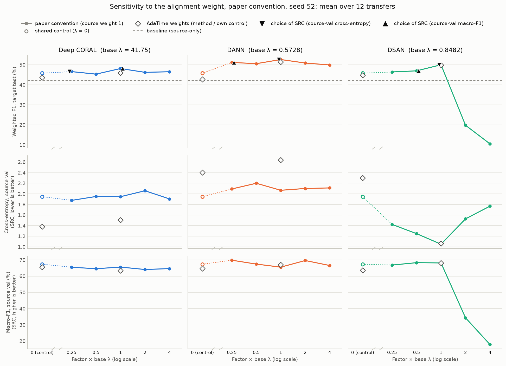

**Figure 8.** Weighted F1 on target test, paper convention at factor 1 minus the run with the AdaTime weights, per transfer; the right panel compares the shared control with each of the three AdaTime controls.

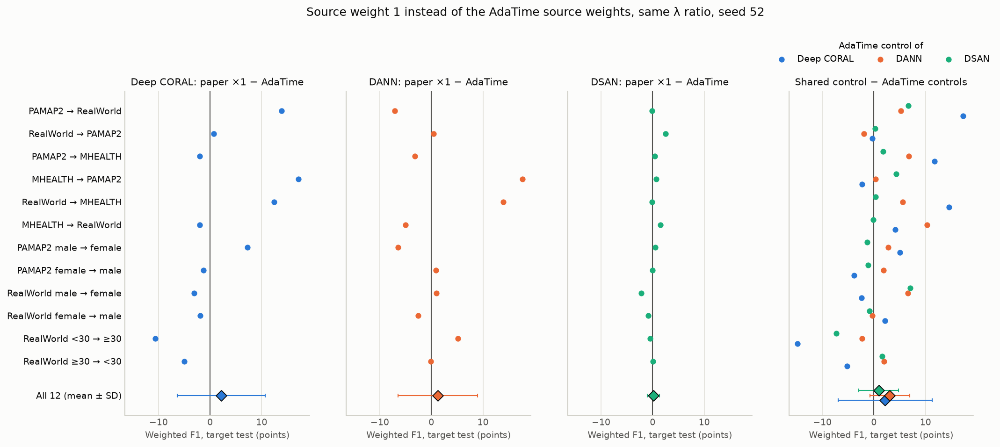

**Figure 9.** Weighted F1 on target test of every factor minus the shared control, per transfer; the framed cell is the factor that SRC (source-val cross-entropy) chooses for that transfer.

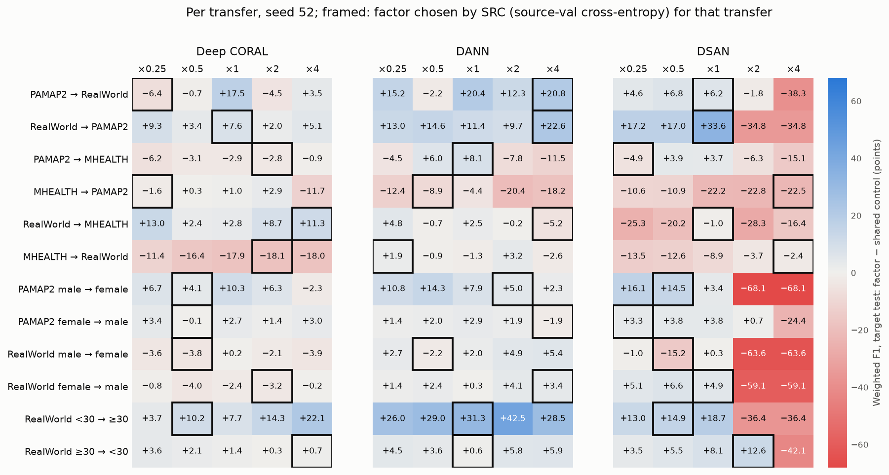

**Observations (sensitivity).** Only statements that follow directly from the T7 tables; one seed, so differences of a few points between factors are within the variation seen between seeds above.

- Deep CORAL: weighted F1 on target test lies between 45.3 and 48.1 % over the five factors (shared control 45.8 %); 4 of 5 factors are above the control.
- DANN: weighted F1 on target test lies between 49.9 and 52.6 % over the five factors (shared control 45.8 %); 5 of 5 factors are above the control.
- DSAN: weighted F1 on target test lies between 10.5 and 50.0 % over the five factors (shared control 45.8 %); 3 of 5 factors are above the control.
- DSAN ×2: in 6 of 12 transfers weighted F1 on source test is below 20 % (the model collapses on the labelled source as well); mean SRC macro-F1 on source val 34.4 %.
- DSAN ×4: in 8 of 12 transfers weighted F1 on source test is below 20 % (the model collapses on the labelled source as well); mean SRC macro-F1 on source val 17.9 %.
- Choices over the mean: Deep CORAL ×0.25 (source-val cross-entropy), ×1 (source-val macro-F1); DANN ×1 (source-val cross-entropy), ×0.25 (source-val macro-F1); DSAN ×1 (source-val cross-entropy), ×0.5 (source-val macro-F1). The two SRC variants pick the same factor for 0 of 3 methods.
- If λ = 0 is a candidate, SRC prefers the control over every factor for Deep CORAL with SRC (source-val macro-F1); DANN with SRC (source-val cross-entropy).
- Paper convention ×1 minus AdaTime weights on target test: Deep CORAL +2.1 ± 8.5 (5/12), DANN +1.2 ± 7.7 (6/12), DSAN +0.2 ± 1.2 (6/12) points.

## Stage 3: uniform soup of the final checkpoints

**Setup.** For every transfer and seed, the three branches of stage 2 (Deep CORAL, DANN, DSAN with the AdaTime weights, last epoch) are averaged with equal weight 1/3 into one model; the same is done with their three control runs. All six runs of a seed start from the same source-only checkpoint, which is checked before averaging. Only the HAR predictor is averaged; the DANN discriminator is not part of the soup. The averaging step is the soup script of the project partner (`create_method_soup.py`). Two BatchNorm variants: *averaged* keeps the averaged running statistics; *re-estimated on target* recomputes them after averaging in one pass over the unlabelled target-train windows (cumulative average over batches of 32, weights unchanged). The output ensemble averages the softmax outputs of the same three models and needs no new weights. No target labels are used for any of this, and no training takes place. Code commit of all soups and ensembles: `586579f`.

**Best branch.** Without target labels, the branch with the lowest cross-entropy or the highest macro-F1 on source validation (SRC) is chosen per transfer and seed. The oracle takes the branch with the highest weighted F1 on target test; **it uses target labels and is shown only as a reference, not as a selection rule.** The source-validation predictions of the branches were computed afterwards from their saved checkpoints (prediction only).

Values are mean ± sample SD over the five seeds in percent; a group value is first averaged over its transfers within each seed. Differences are paired by transfer and seed; in brackets the number of seeds in which the first variant is higher, and for all transfers also the number of the 60 transfer-seed pairs.

**Weighted F1 on target test (%): Soup of the methods (Deep CORAL + DANN + DSAN)**

| Variant | All 12 | Cross-dataset (6) | Cross-gender (4) | Cross-age (2) |
|---|---:|---:|---:|---:|
| Baseline | 41.9 ± 1.0 | 25.1 ± 1.6 | 65.2 ± 1.3 | 45.7 ± 3.5 |
| Mean of the 3 branches | 50.3 ± 1.5 | 35.2 ± 3.4 | 70.0 ± 1.2 | 56.4 ± 1.2 |
| Best branch by SRC (CE) | 52.4 ± 2.4 | 37.5 ± 5.2 | 71.3 ± 3.2 | 59.6 ± 4.2 |
| Best branch by SRC (macro-F1) | 52.0 ± 2.3 | 35.9 ± 5.4 | 72.6 ± 2.7 | 58.9 ± 3.5 |
| Best branch by target test (oracle) | 58.0 ± 1.6 | 44.7 ± 2.7 | 75.6 ± 1.4 | 62.8 ± 2.8 |
| Output ensemble | 51.8 ± 2.4 | 35.3 ± 5.4 | 72.6 ± 1.5 | 59.4 ± 1.4 |
| Soup, BN averaged | 43.0 ± 2.7 | 29.5 ± 2.4 | 63.5 ± 3.8 | 42.2 ± 10.1 |
| Soup, BN re-estimated on target | 42.9 ± 2.4 | 30.7 ± 5.0 | 59.3 ± 2.8 | 46.8 ± 5.2 |

**Weighted F1 on target test (%): Soup of the controls (their three λ = 0 runs)**

| Variant | All 12 | Cross-dataset (6) | Cross-gender (4) | Cross-age (2) |
|---|---:|---:|---:|---:|
| Baseline | 41.9 ± 1.0 | 25.1 ± 1.6 | 65.2 ± 1.3 | 45.7 ± 3.5 |
| Mean of the 3 branches | 44.2 ± 1.3 | 28.6 ± 2.2 | 65.5 ± 1.9 | 48.3 ± 2.4 |
| Best branch by SRC (CE) | 44.2 ± 2.9 | 27.9 ± 5.5 | 65.6 ± 2.2 | 50.1 ± 4.5 |
| Best branch by SRC (macro-F1) | 44.9 ± 2.3 | 29.4 ± 3.6 | 65.7 ± 2.1 | 49.8 ± 1.1 |
| Best branch by target test (oracle) | 48.1 ± 1.7 | 33.1 ± 2.3 | 68.5 ± 1.7 | 52.6 ± 1.3 |
| Output ensemble | 45.2 ± 1.6 | 29.3 ± 2.4 | 66.7 ± 1.7 | 50.0 ± 1.2 |
| Soup, BN averaged | 43.3 ± 2.5 | 26.6 ± 4.4 | 66.4 ± 1.8 | 47.4 ± 2.8 |
| Soup, BN re-estimated on target | 45.8 ± 1.2 | 30.0 ± 1.8 | 67.4 ± 1.9 | 49.9 ± 1.6 |

**Paired differences in weighted F1 on target test (points)**

| Difference | All 12 | Cross-dataset (6) | Cross-gender (4) | Cross-age (2) |
|---|---:|---:|---:|---:|
| Methods, BN averaged: Soup − mean of the branches | −7.4 ± 2.2 (0/5) | −5.6 ± 2.9 (0/5) | −6.5 ± 3.9 (0/5) | −14.2 ± 11.1 (1/5) |
| Methods, BN averaged: Soup − best branch by SRC (CE) | −9.5 ± 2.2 (0/5) | −7.9 ± 3.6 (0/5) | −7.8 ± 5.5 (0/5) | −17.4 ± 13.2 (1/5) |
| Methods, BN averaged: Soup − best branch by SRC (macro-F1) | −9.0 ± 2.7 (0/5) | −6.3 ± 4.5 (0/5) | −9.1 ± 1.8 (0/5) | −16.7 ± 11.8 (1/5) |
| Methods, BN averaged: Soup − best branch by target test (oracle, uses target labels) | −15.1 ± 2.8 (0/5) | −15.2 ± 2.2 (0/5) | −12.1 ± 4.2 (0/5) | −20.6 ± 12.0 (0/5) |
| Methods, BN averaged: Soup − baseline | +1.1 ± 3.0 (3/5) | +4.5 ± 2.3 (5/5) | −1.7 ± 3.1 (2/5) | −3.5 ± 13.0 (2/5) |
| Methods, BN averaged: Soup − output ensemble | −8.8 ± 2.2 (0/5) | −5.7 ± 4.4 (0/5) | −9.1 ± 3.6 (0/5) | −17.2 ± 10.4 (0/5) |
| Methods, BN re-estimated on target: Soup − mean of the branches | −7.4 ± 1.0 (0/5) | −4.5 ± 3.6 (0/5) | −10.7 ± 3.0 (0/5) | −9.6 ± 5.8 (1/5) |
| Methods, BN re-estimated on target: Soup − best branch by SRC (CE) | −9.5 ± 1.2 (0/5) | −6.7 ± 3.1 (0/5) | −12.0 ± 2.0 (0/5) | −12.8 ± 7.0 (0/5) |
| Methods, BN re-estimated on target: Soup − best branch by SRC (macro-F1) | −9.0 ± 0.6 (0/5) | −5.1 ± 3.8 (0/5) | −13.3 ± 4.6 (0/5) | −12.1 ± 6.2 (0/5) |
| Methods, BN re-estimated on target: Soup − best branch by target test (oracle, uses target labels) | −15.1 ± 2.0 (0/5) | −14.0 ± 4.1 (0/5) | −16.3 ± 2.2 (0/5) | −16.0 ± 5.9 (0/5) |
| Methods, BN re-estimated on target: Soup − baseline | +1.0 ± 2.3 (3/5) | +5.7 ± 4.6 (5/5) | −5.9 ± 3.4 (0/5) | +1.1 ± 7.2 (2/5) |
| Methods, BN re-estimated on target: Soup − output ensemble | −8.8 ± 0.5 (0/5) | −4.6 ± 3.9 (0/5) | −13.3 ± 3.6 (0/5) | −12.7 ± 5.2 (0/5) |
| Methods: BN re-estimated − BN averaged | −0.1 ± 2.5 (1/5) | +1.2 ± 2.8 (4/5) | −4.2 ± 5.4 (1/5) | +4.6 ± 6.6 (3/5) |
| Controls, BN averaged: Soup − mean of the branches | −0.9 ± 1.2 (2/5) | −2.1 ± 2.3 (2/5) | +0.9 ± 0.9 (4/5) | −0.9 ± 3.8 (2/5) |
| Controls, BN averaged: Soup − best branch by SRC (CE) | −0.9 ± 1.3 (1/5) | −1.4 ± 1.6 (2/5) | +0.8 ± 0.7 (5/5) | −2.7 ± 6.6 (2/5) |
| Controls, BN averaged: Soup − best branch by SRC (macro-F1) | −1.6 ± 1.1 (0/5) | −2.8 ± 1.6 (0/5) | +0.7 ± 0.7 (5/5) | −2.4 ± 2.6 (1/5) |
| Controls, BN averaged: Soup − best branch by target test (oracle, uses target labels) | −4.8 ± 1.2 (0/5) | −6.5 ± 2.4 (0/5) | −2.1 ± 0.5 (0/5) | −5.2 ± 4.0 (0/5) |
| Controls, BN averaged: Soup − baseline | +1.4 ± 3.1 (4/5) | +1.5 ± 5.2 (2/5) | +1.2 ± 2.9 (4/5) | +1.7 ± 4.2 (4/5) |
| Controls, BN averaged: Soup − output ensemble | −1.9 ± 1.1 (0/5) | −2.7 ± 2.3 (0/5) | −0.2 ± 1.3 (1/5) | −2.6 ± 2.6 (1/5) |
| Controls, BN re-estimated on target: Soup − mean of the branches | +1.6 ± 0.5 (5/5) | +1.3 ± 1.6 (4/5) | +1.8 ± 1.0 (5/5) | +1.6 ± 1.7 (5/5) |
| Controls, BN re-estimated on target: Soup − best branch by SRC (CE) | +1.6 ± 2.3 (4/5) | +2.0 ± 5.0 (3/5) | +1.8 ± 1.5 (4/5) | −0.1 ± 4.5 (2/5) |
| Controls, BN re-estimated on target: Soup − best branch by SRC (macro-F1) | +0.9 ± 1.6 (3/5) | +0.6 ± 3.2 (3/5) | +1.6 ± 1.5 (4/5) | +0.2 ± 2.0 (2/5) |
| Controls, BN re-estimated on target: Soup − best branch by target test (oracle, uses target labels) | −2.4 ± 0.8 (0/5) | −3.1 ± 1.4 (0/5) | −1.1 ± 1.2 (0/5) | −2.6 ± 2.4 (1/5) |
| Controls, BN re-estimated on target: Soup − baseline | +3.9 ± 1.9 (5/5) | +4.9 ± 2.5 (5/5) | +2.2 ± 3.0 (4/5) | +4.3 ± 2.6 (5/5) |
| Controls, BN re-estimated on target: Soup − output ensemble | +0.6 ± 0.9 (4/5) | +0.7 ± 1.7 (3/5) | +0.7 ± 0.5 (5/5) | −0.1 ± 0.5 (1/5) |
| Controls: BN re-estimated − BN averaged | +2.4 ± 1.6 (5/5) | +3.4 ± 3.6 (4/5) | +1.0 ± 1.2 (4/5) | +2.5 ± 2.4 (4/5) |
| Soup of the methods − soup of the controls, BN averaged | −0.4 ± 4.0 (2/5) | +3.0 ± 6.0 (3/5) | −2.9 ± 4.9 (2/5) | −5.2 ± 10.2 (2/5) |
| Soup of the methods − soup of the controls, BN re-estimated on target | −2.9 ± 1.9 (1/5) | +0.7 ± 4.5 (3/5) | −8.1 ± 1.6 (0/5) | −3.2 ± 5.9 (1/5) |
| Context: mean of the method branches − mean of the control branches | +6.1 ± 1.5 (5/5) | +6.6 ± 3.3 (5/5) | +4.5 ± 1.1 (5/5) | +8.0 ± 1.9 (5/5) |

**Costs.** Averaging three checkpoints takes 11 ms per soup; re-estimating the BatchNorm statistics takes 2.0 s per soup (one pass over target train in batches of 32 on MPS). Training the three branches of one soup took 222 s on average. A soup is evaluated at the cost of one model, the ensemble at the cost of three. Details: `results/tables/T8_costs.csv`, `T8_costs_summary.csv`.

**Figure 10.** Weighted F1 on target test per group: the baseline, the mean of the three branches, the output ensemble and the two soups; left the soup of the methods, right the soup of the control runs (hatched). Error bars: SD over the seeds.

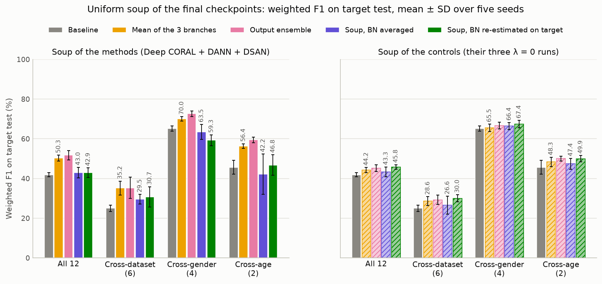

**Figure 11.** Soup of the three methods minus its references per transfer, for both BatchNorm variants; points right of zero mean the soup is higher. The fourth panel uses target labels to choose the branch and is a reference only.

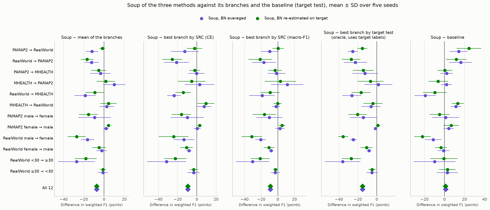

**Figure 12.** Left: soup of the methods minus soup of the controls (what the alignment losses contribute inside the soup). Middle: re-estimated minus averaged BatchNorm statistics (filled: methods, open: controls). Right: soup minus output ensemble of the same three models.

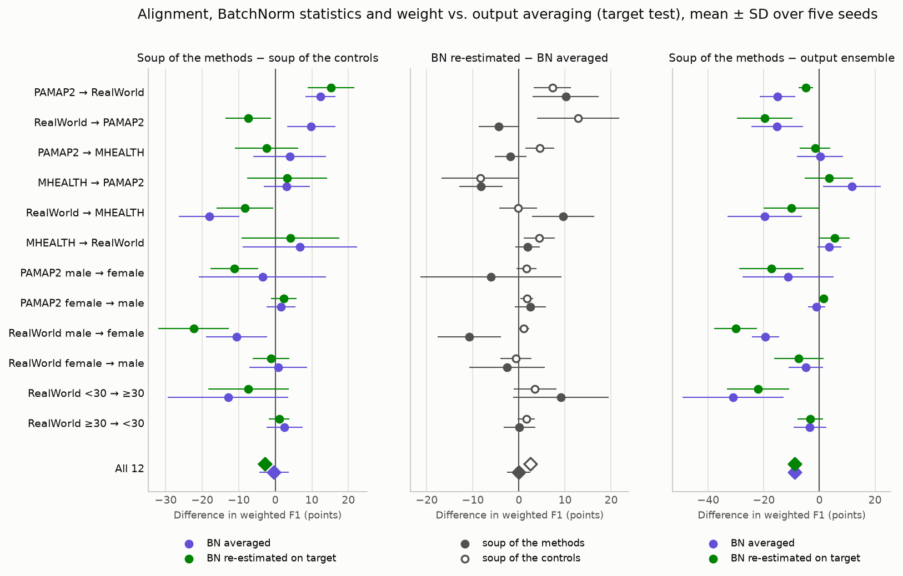

**Observations (soup).** Only statements that follow directly from the T8 tables; no causes are claimed.

- Soup of the methods (Deep CORAL + DANN + DSAN), all 12 transfers: Baseline 41.9 ± 1.0 %, Mean of the 3 branches 50.3 ± 1.5 %, Best branch by SRC (CE) 52.4 ± 2.4 %, Best branch by SRC (macro-F1) 52.0 ± 2.3 %, Best branch by target test (oracle) 58.0 ± 1.6 %, Output ensemble 51.8 ± 2.4 %, Soup, BN averaged 43.0 ± 2.7 %, Soup, BN re-estimated on target 42.9 ± 2.4 %.
- Soup of the controls (their three λ = 0 runs), all 12 transfers: Baseline 41.9 ± 1.0 %, Mean of the 3 branches 44.2 ± 1.3 %, Best branch by SRC (CE) 44.2 ± 2.9 %, Best branch by SRC (macro-F1) 44.9 ± 2.3 %, Best branch by target test (oracle) 48.1 ± 1.7 %, Output ensemble 45.2 ± 1.6 %, Soup, BN averaged 43.3 ± 2.5 %, Soup, BN re-estimated on target 45.8 ± 1.2 %.
- Soup, BN averaged (methods), differences over all transfers: mean of the branches −7.4 ± 2.2 (0/5), 18/60 pairs; best branch by SRC (CE) −9.5 ± 2.2 (0/5), 15/60 pairs; best branch by SRC (macro-F1) −9.0 ± 2.7 (0/5), 14/60 pairs; best branch by target test (oracle, uses target labels) −15.1 ± 2.8 (0/5), 7/60 pairs; baseline +1.1 ± 3.0 (3/5), 33/60 pairs; output ensemble −8.8 ± 2.2 (0/5), 17/60 pairs.
- Soup, BN averaged (methods) minus the mean of its branches by group: Cross-dataset (6) −5.6 ± 2.9 (0/5); Cross-gender (4) −6.5 ± 3.9 (0/5); Cross-age (2) −14.2 ± 11.1 (1/5).
- Soup, BN re-estimated on target (methods), differences over all transfers: mean of the branches −7.4 ± 1.0 (0/5), 18/60 pairs; best branch by SRC (CE) −9.5 ± 1.2 (0/5), 15/60 pairs; best branch by SRC (macro-F1) −9.0 ± 0.6 (0/5), 17/60 pairs; best branch by target test (oracle, uses target labels) −15.1 ± 2.0 (0/5), 8/60 pairs; baseline +1.0 ± 2.3 (3/5), 29/60 pairs; output ensemble −8.8 ± 0.5 (0/5), 20/60 pairs.
- Soup, BN re-estimated on target (methods) minus the mean of its branches by group: Cross-dataset (6) −4.5 ± 3.6 (0/5); Cross-gender (4) −10.7 ± 3.0 (0/5); Cross-age (2) −9.6 ± 5.8 (1/5).
- BN re-estimated minus BN averaged, methods: −0.1 ± 2.5 (1/5), 31/60 pairs; source test weighted F1 66.8 % (averaged) and 66.6 % (re-estimated), mean of the branches 77.6 %.
- BN re-estimated minus BN averaged, controls: +2.4 ± 1.6 (5/5), 48/60 pairs; source test weighted F1 76.2 % (averaged) and 77.1 % (re-estimated), mean of the branches 75.8 %.
- Without target labels, on source validation (SRC, mean over transfers and seeds), methods: macro-F1 of the branches 66.1 to 69.0 %, soup 56.4 % (BN averaged) and 53.7 % (re-estimated), ensemble 68.8 %; cross-entropy of the branches 1.31 to 2.24, soup 1.69 and 4.70.
- Without target labels, on source validation (SRC, mean over transfers and seeds), controls: macro-F1 of the branches 66.0 to 67.5 %, soup 66.6 % (BN averaged) and 68.2 % (re-estimated), ensemble 67.7 %; cross-entropy of the branches 1.48 to 2.27, soup 1.63 and 1.94.
- Soup of the methods minus soup of the controls (BN averaged): −0.4 ± 4.0 (2/5), 34/60 pairs; the same difference between the means of the branches: +6.1 ± 1.5 (5/5), 45/60 pairs.
- Soup of the methods minus soup of the controls (BN re-estimated on target): −2.9 ± 1.9 (1/5), 25/60 pairs; the same difference between the means of the branches: +6.1 ± 1.5 (5/5), 45/60 pairs.
- Transfers on which the soup of the methods is above the best branch by target test (oracle) in the mean over seeds: Soup, BN averaged: MHEALTH → PAMAP2; Soup, BN re-estimated on target: PAMAP2 female → male.
- Branch chosen per transfer and seed (60 cases) among Deep CORAL / DANN / DSAN: Best branch by SRC (CE): deep_coral 18, dann 3, dsan 39; Best branch by SRC (macro-F1): deep_coral 8, dann 21, dsan 31; Best branch by target test (oracle): deep_coral 9, dann 23, dsan 28.

## Limitations

Five seeds, the last epoch without model selection, loss weights taken over from another benchmark without tuning, and small target test sets on some transfers limit what these numbers show. See [limitations.md](limitations.md).
